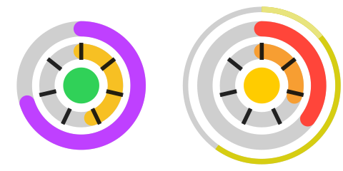

# Claude Limits

<p align="center"></p>

A tiny macOS menu-bar app that shows — at a glance — how much of your Claude
and Codex usage is left and whether your current pace will blow through it.

## What it solves

Claude Code / claude.ai usage runs against a **rolling 5-hour session limit** and
a **weekly cap**, and you usually only discover you've hit one when you get
rate-limited in the middle of something. This app keeps both limits in your menu
bar, projects your current **burn rate** forward — counting only your working
hours — and colours a warning *before* you run out, so you can pace yourself or
take a break instead of getting cut off.

## How to read the dial

Two circular dials side-by-side: Claude on the left, Codex on the right. Each
dial has two concentric rings, split left/right:

```
          outer ring          inner ring
  left     Short-window % left      Short window: time since reset
  right    Long-window  % left      Long window:  time since reset
```

- **Quota arcs** (outer) — how much quota is left, coloured by the same
  since-reset pace projection as the Claude Code statusline, but on your
  **working-hours clock**: the time elapsed and left is counted in working
  hours, so an evening's spend is projected over the working time left in
  the window, not over 24-hour days. The first 10% of a window normally stays
  grey because an early burst is too noisy to extrapolate. An obvious early burn (at least 30 minutes of history and 5% of
  real spend) breaks out of that learning state immediately:
  - ⚪ grey — reset time is unknown, or the window is still in that learning period
  - 🟣 purple — projected to leave more than 10% of the quota unused
  - 🟢 green — projected to use 90–100% by reset
  - 🟡 yellow — projected to run out, but only for a short tolerable gap before reset
  - 🔴 red — projected to run out with a longer gap before reset

  The tolerable gap is 30 minutes for a short (5h) window and 12 hours for a
  long (weekly) window. A light-grey tail on the session arc still means the
  weekly cap makes that part of the session quota unspendable.
- **Weekly notches** (outer right) — thin separators slice the weekly arc into
  **"one full 5-hour session" blocks**, so the notches still lit tell you *how
  many more whole sessions* of weekly budget you have. The block size is
  **measured from your own spending** (no synthetic default) — until a real spend
  lands the menu reads "calibrating…".
- **Time arcs** (inner) — grow **greener as the reset nears** (fresh quota is
  coming soon). Pick how they *fill* from **Time ring** in the menu — either by
  time *elapsed* (default) or by time *left*; the colour is the same either way.
  Fixed tick marks split each time ring into known units — the **session by
  hours**, the **weekly by days**.
- **Centre dot** — the worst known outer-ring pace category. An unknown/learning
  window does not mask a known warning from the other window; the dot is grey
  only while both windows are still unknown.
- **Corner dots** — one dot per limit reset you hold, filling the corners of
  that dial's box from the top-left clockwise (four at most; the menu's
  **Resets available** row has the full count). **Blue** is a general reset,
  **purple** one that refills a single model's limit (e.g. Fable).
- **Single-limit mode** — when only **one** window is in play (Codex handing
  out only a weekly limit, or a Claude account whose usage response carries
  `five_hour: null` and no session limit) the dial auto-collapses to **one big
  full circle** for that window instead of a half-empty pair of semicircles.
  On such a Claude account the session rows (session %, its reset, the 5h-block
  calibration, the session forecast) are hidden from the menu, the speed and
  spare lines speak only about the weekly limit, and the Claude 1h/5h chart
  cards show slices of the weekly history. They all come back as soon as a
  5-hour window reappears in the response.
- **Thin edge ring (credits)** — drawn only when the provider has a credit
  budget (Claude *extra usage* / usage credits, Codex purchased credits). The
  whole circle is the **time until the longest window resets**; the lit arc,
  from the top clockwise, is **how much of that time the balance covers at the
  recent (15‑minute) burn rate** — e.g. credits that last two days with four
  days to the reset light half the ring. It reddens as the cover shrinks
  (green = lasts to reset). The **lighter head** of the arc is **the next 24
  hours' spend** at that rate. A plain grey ring means the budget exists but
  can't be projected yet (no rate measured or no reset time); a red ring means
  the balance is exhausted. No budget → no ring, the icon is as before.
- **Spend pulse** — every time a provider's quota % ticks up, that dial plays a
  short burst: the centre dot flashes and swells, the rim flares, and a
  shockwave rolls **out of the icon** throwing sparks across the menu bar and
  the screen below it — the fat ones burst into fragments on the way, like a
  firework. The sparks are drawn in a borderless, click-through
  window layered over the menu bar (the icon itself can't paint outside its own
  rectangle), so nothing about the icon's size or position changes. Pick
  **Spend pulse** in the dropdown: *off*, *pulse the dial* (inside the icon
  only), *pulse + sparks* (the default) or *firework* — which throws the burst
  clear across the screen, a quarter of its height by default and adjustable
  from 1/8 to 1/2 under **Firework size**. Every burst runs in three stages:
  shells fly out, split into fragments, and those split again, all of it
  drifting down as it fades. **Test it now** plays a burst on both dials so you
  can see it without waiting for a poll to find spend. Only quota counters pulse — credits don't — and a restart never
  replays spend from the previous run.
- On an error that side's dial goes all-grey with a **red blinking** dot —
  Claude and Codex each blink on their own.

Click it for everything as numbers, plus your account.

## What it can do

- Live **session (5h)** and **weekly** limits — % remaining and time to reset.
- A **burn-rate forecast** per window, projected over your **working hours**
  (so the weekly burn reflects ~9h workdays, not 24h of wall-clock). The dial
  colours and the chart's affordable pace use the same clock.
- Configurable **working hours** (30-min steps, default 09:00–18:00, may wrap
  past midnight like 09:00–02:00) — picked from the dropdown, saved to disk.
- **Burn-driven icon size** — the menu-bar icon **grows while tokens are
  actively burning** (18→24 pt, scored per window so a fast weekly burn and a
  fast 5h burn count equally) and shrinks back when idle. On by default; turn it
  off to pin a fixed **icon size** (14–24 pt, default 19). This toggle, the
  **Time ring** fill direction and the **Spend pulse** mode are picked from the
  dropdown and saved to disk.
- **Weekly limit in 5-hour-session blocks** — the dropdown spells out the dial's
  notches as "≈ N / M × 5h blocks left", with the calibrated cost of one block
  (weekly-% per session) and the spend basis it was measured from, globally and
  **per model**.
- Consumption **speed** two ways — a **recent** rate and the **average since the
  window opened** — with session in **%/h** and weekly in **%/d** (Codex
  windows pick the unit the same way, by their length), each with the
  **spare left at reset** if that pace holds. The recent line is labelled with
  the **actual span it was measured over** (nominally ~15 min, but widening to the
  real gap between polls when they're sparse — e.g. "Last 12m" — so a slow or
  manual refresh never misreads as 0).
- **Quota strip** at the very top of the menu — one row per real quota window
  (Claude's 5h and 7d plus credits on the left, Codex's two windows plus
  credits on the right). Each row spells out the **time to that window's
  reset** in 13-point digits beside the wall-clock moment it lands, so the
  countdown is readable without squinting, and repeats it once per window
  rather than once per chart. Next to it sits a compact **speed bar** — the
  old dial speedometer rolled flat, on the same 0–2× scale against the pace
  you can still **afford before the reset** (quota left ÷ working time left):
  purple under pace, green at exactly 1× (runs out precisely at the reset),
  yellow at 1¼×, red at 1½× or more, with fixed **½× / 1× / 1½×** notches, an
  accent pip below marking where the plain whole-window pace currently sits on
  that scale (left of 1× you can go faster than normal, right of it even
  normal is too fast), and a thin bar above comparing the last 5 minutes with
  the last 15 — right means accelerating (green → yellow → red), left means
  easing off (green → blue → purple). `LEFT` closes the row with the runway
  read two ways: at the **15-minute rate** and at the **average since the
  window opened**. A window with nothing measured, or with nothing finite to
  pace against (an unlimited credit balance, or no reset), greys out instead
  of reading zero. Credits keep the wall clock throughout: they only burn
  while the plan quota is exhausted, so their row counts down to the reset
  that brings plan quota back.
- **Paired burn history** under the strip — Claude is always the left
  card and Codex the right card, with large high-resolution timelines and
  separate totals and scales for the last hour, the short window, the last
  **24 hours**, and the long window. Neither provider exposes a daily quota, so
  the 24h card is the long window seen over a day — the pace line it is read
  against is still the weekly budget, which makes it answer "how much of the
  week did today cost". Each
  independent scale has three speed labels on the right in `%/h` or `%/d`, plus
  start/midpoint/end time labels along the bottom. Both APIs report quota in
  whole percent, so every bar is one run between counter changes: a 1% step is
  spread evenly over the flat polls since the previous step, giving the exact
  average speed of that run instead of a spike at the poll that happened to
  reveal it. The run still waiting for its next step is drawn at zero. The
  dashed line, drawn over the burn, is the **affordable pace** at each moment
  of the chart: the quota that was still left then ÷ the **working time** that
  was left to that window's reset (the same working-hours clock as the menu's
  forecast rows, so a night or a weekend never makes the pace look tighter).
  It climbs while nothing is spent (the same remainder over a shrinking
  wait), holds flat outside working hours, drops with every run, starts over
  at each observed reset, and is clipped to the top of the plot just before a
  reset, where almost any speed is affordable. Bar and area colour compare each run's
  speed with the pace affordable at that moment on the speed bar's scale,
  which follows the dial: purple when under pace, green at exactly 1× (runs
  out precisely at the reset, like the credits ring), yellow at 1¼×, red at
  1½× or more. The y axis is scaled from the flat whole-window pace (over
  the window's working hours) instead, so it stays put while the reference
  curve moves. If a window's reset is
  unknown the line falls back to that flat pace. The 1h, 5h and 24h rows blur
  those runs into a smooth area (a Gaussian of 1/60 of the horizon, so ~60s,
  ~5min and ~24min) drawn over the raw bars at low opacity. The blur never leaks
  past the window edges, so the area's integral equals the bars' integral and
  the SPENT total exactly, and any run faster than the blur pokes out above it
  as a faint stub, so outliers stay visible. The 7d row's width is a menu
  choice, **7d smoothing**: plain bars,
  30 min, 1 hour (default), 2 hours or 4 hours. The
  headline figure in the card's top-right corner — set at 16 points, since it
  is the one number the card exists for — is labelled **SPENT** and counts from
  the **last reset in view** (every observed reset is drawn as a thin vertical dashed
  line on the plot), so the previous window's burn is never added to the
  current one; with no reset in view it is the spend across the whole chart.
  Everything else a card used to carry — the reset countdown, the runways, the
  measurement span and the speedometer — described the quota window rather than
  this horizon, and now lives once on the strip. A weekly-only Codex limit is placed in the long-window row even when the API
  calls it `primary`; its real utilisation history is also shown as a 5-hour
  slice in the middle row instead of leaving that Codex card empty.
- **Credits runway** for both providers — a `Credits:` row with the balance
  (and the monthly cap / % used where Claude reports one) plus an indented
  detail row: how long the balance lasts at the recent rate **against the time
  to reset** and what one more day costs (`lasts 2d 3h of 4d 2h to reset (52%)
  · ≈ $6.10/day`). Claude's figure comes from `spend` (usage credits) when
  enabled, otherwise from `extra_usage`; extra-usage amounts are read as minor
  units scaled by `decimal_places`. Codex credits are tracked as a running
  counter of balance drops, since its API only reports the balance.
- A fifth **Credits 5h** chart row (Claude left, Codex right) in credit units:
  bars are credits spent per run between balance changes, the dashed line is
  the pace that would have spent the balance left at each moment exactly by
  the reset (only for the current period — an earlier period's budget is not
  recorded), and the strip's average runway for credits is taken over the last
  24 h.
- **Per-model** weekly limits.
- Two peer dropdown blocks — **Claude** and **Codex** — each with its plan,
  both usage windows, forecast, speed, credits, **available rate-limit
  resets** and per-model/additional limits (Codex also shows the signed-in
  account). Claude's usage API does not expose reset credits today, so its row
  reads "—" until a `rate_limit_reset_credits` field appears in the response.
- Shows the active Claude account and provides **Use current Claude login** to
  reload `Claude Code-credentials` immediately after switching accounts.
- **Next reset at a glance** — the strip counts every window down, and each
  block title carries its own countdown to the soonest of its windows
  (`Claude · Claude Max 20× · ↻ 3d 4h`). Both tick every second.
- **A short top level** — the charts, the two provider blocks, **Settings**
  (working hours, icon size, time ring, spend pulse, 7d smoothing, the dial
  legend), **Status** (the last success/failure rows for both providers),
  Refresh and Quit. Text rows are kept narrower than the chart images, and the
  status line is elided, so the dropdown is as wide as the charts rather than
  as wide as a sentence of explanation.
- Polls in the background with a live "requesting…" indicator; on errors it
  keeps showing the **last good values for 10 minutes** before going grey.
  The bottom of the menu lists **separate last success / last failure** rows
  for Claude and for Codex, the failure row carrying the error it hit.
- **Adaptive polling**: starts at one poll every **2 minutes** and self-tunes —
  each `429` grows the interval (×1.5, up to 10 min) and a run of clean polls
  shrinks it back — so it converges on a rate the usage endpoint accepts instead
  of hammering it every 30 s. The interval is remembered across restarts.
- **Backoff that respects the server**: on `429` it honours `retry-after` /
  ratelimit-reset headers, otherwise exponential with jitter capped at **10
  minutes** — and remembers the next-allowed poll time across restarts so
  relaunching doesn't immediately re-hit a 429. Failures that only clear when
  something external recovers — a **network outage** or an **expired token**
  (401/403, waiting for Claude Code to refresh it) — don't back off: they retry
  **once a minute** until they recover.
- **Request/response logging**: each call to the usage API — its status,
  duration, and body — is logged to **stderr**; the bearer token is never
  logged.
- Caches the **account, plan, last quota values and rate**, and saves on quit
  **and Ctrl-C** — so a restart is populated instantly.

## Run

```sh
./claude_limits.sh
```

### Start at login (optional)

Add `claude_limits.sh` as a Login Item, or via `launchd`:

```sh
cat > ~/Library/LaunchAgents/com.local.claude-limits.plist <<PLIST
<?xml version="1.0" encoding="UTF-8"?>
<!DOCTYPE plist PUBLIC "-//Apple//DTD PLIST 1.0//EN"
  "http://www.apple.com/DTDs/PropertyList-1.0.dtd">
<plist version="1.0"><dict>
  <key>Label</key><string>com.local.claude-limits</string>
  <key>ProgramArguments</key>
  <array><string>$PWD/claude_limits.sh</string></array>
  <key>RunAtLoad</key><true/>
</dict></plist>
PLIST
launchctl load ~/Library/LaunchAgents/com.local.claude-limits.plist
```

## Data source

It reads the same OAuth endpoint Claude Code's `/usage` screen uses
(`api.anthropic.com/api/oauth/usage`). The bearer token comes from the
`Claude Code-credentials` keychain item, which Claude Code keeps fresh while you
work. When that token is still valid the app just uses it (never interfering);
when it's expired and Claude Code is idle (e.g. overnight) the app mints a fresh
one itself — the same request Claude Code 2.1.263 sends
(`platform.claude.com/v1/oauth/token`, its client id and scope list) — and
**writes the new token pair back into the keychain item** exactly as Claude
Code does (`security -i`, payload hex-encoded on stdin, every other field of
the item preserved). Refresh tokens rotate, so without the write-back a
self-refresh would strand Claude Code's own copy. The keychain's refresh token
is always tried first (Claude Code may have rotated it since the app last
looked); the app's persisted copy is only a fallback. A failed refresh is
reported as such in the status (`Claude token refresh rate-limited (429)`,
`Claude refresh token rejected …`), never retried more than once per two
minutes, and never followed by a request with the expired token. If the
refresh token itself is rejected it is dead until you reopen Claude Code, and
the status says so. After changing accounts in Claude Code,
click **Use current Claude login** in the Claude menu to discard the old cached
token and immediately reload the current keychain credentials, profile, and
limits.

For Codex it reads the ChatGPT-authenticated Codex usage endpoint
(`chatgpt.com/backend-api/wham/usage`). On first run the token is bootstrapped
the same way the Codex CLI stores it: `CODEX_ACCESS_TOKEN`, `~/.codex/auth.json`,
or the macOS keychain item `Codex Auth`. From then on it keeps the **refresh
token** in its state file and mints fresh access tokens itself (OpenAI's OAuth
endpoint, the same flow the Codex CLI uses) — so the keychain is touched at most
once and you won't be re-prompted for a password on every launch. It only falls
back to the keychain if refreshing fails (e.g. you signed out and back in), or
when you click **Use current Codex login** in the Codex menu to replace a stale
saved token after switching accounts. Keep Codex signed in with ChatGPT
(`codex login`); API-key auth does not expose ChatGPT plan limits. Requests go
through the system `curl`; no network or crypto libraries are added.

## Code

A single Go program (SVG icon rendering, menu bar via a repo-local patched
`getlantern/systray`), split into files:

- `helpers.go` — pure time/format/backoff functions (no GUI deps).
- `api.go` — `Client` (keychain token + curl) and `APIError`.
- `forecast.go` — `Forecast` (burn projection + gradient) and `RateTracker`.
- `credits.go` — credit budgets (Claude extra usage / spend, Codex balance),
  their runway projection, and the credits menu text.
- `history.go` — per-series utilisation log and the burn-history charts.
- `strip.go` — the quota strip above them: reset countdowns and speed bars.
- `dial.go` — `renderDial`, the SVG icon drawn from the `SEGMENTS` table.
- `pulse.go` — the spend-pulse animation: burst envelope, shockwave and sparks.
- `overlay.go` — paints that burst in a window around the menu-bar icon.
- `app.go` — `App`: polling loop, state, and rendering.
- `menu.go` — menu-bar layout and the working-hours pickers.
- `main.go` — thin entry point.

```sh
go build -o claude-limits . && go test ./...
```
