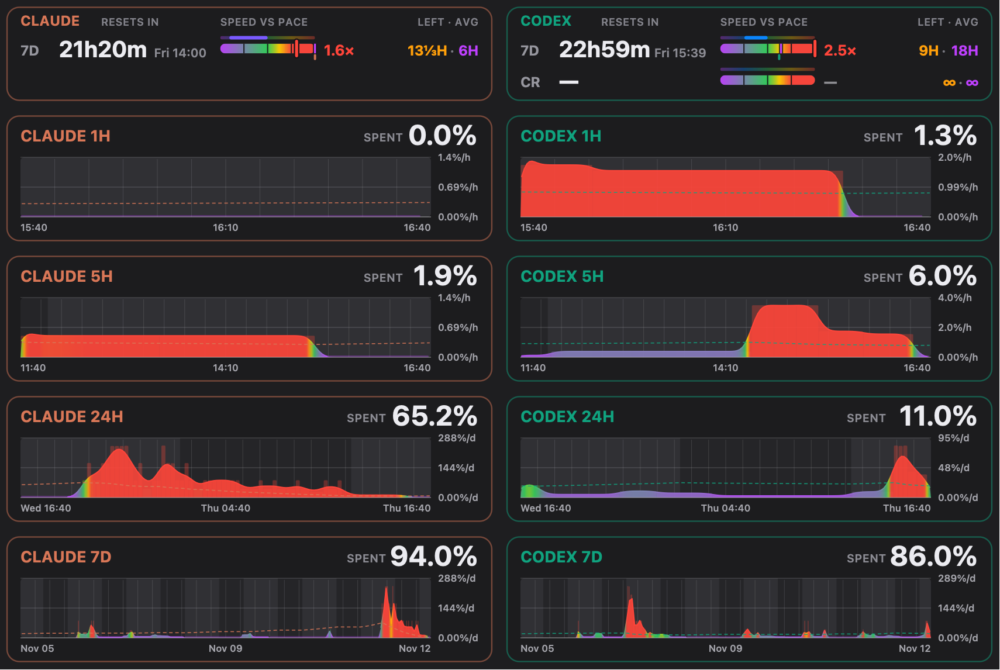

# Claude Limits

<p align="center"></p>

A tiny macOS menu-bar app that shows how fast your Claude and Codex quota is
burning — not just how much is left — so you can plan the work around it.

## What it solves

Claude and Codex meter usage against **quota windows** — a rolling 5-hour
session, a weekly cap, sometimes a credit balance on top. The providers tell
you how much of a window is used. They don't tell you the thing you need in
order to plan: **how fast it is going**, and whether that speed is one you can
keep up until the reset.

Without that you find out too late. Either you get rate-limited in the middle
of something with days still to go, or the week ends with a third of the quota
unspent because you were being careful for no reason.

This app measures the burn rate and puts it next to the one number that gives
it meaning — the **pace you can afford**: quota left ÷ working time left until
the reset. That turns "71% left" into answers you can act on:

- **Am I going too fast?** Current speed against the affordable pace, as a
  multiple (`1.6×`) and as a colour, on the icon and in the menu.
- **How long will it last?** The runway at the current rate, next to the time
  to the reset.
- **What did that cost?** Per-hour, per-session, per-day and per-week history,
  so you can see which task or parallel run ate the quota.
- **Can I afford more?** Under pace there is room to start another agent or
  switch to a heavier model; over pace it is time to slow down, move the heavy
  job to after the reset, or shift it to the other provider.

Time is counted in **your working hours**, so a night or a weekend never makes
the pace look tighter than it is.

## How to read the dial

Two circular dials side-by-side: Claude on the left, Codex on the right. Each
dial has two concentric rings, split left/right:

```
          outer ring          inner ring
  left     Short-window % left      Short window: time since reset
  right    Long-window  % left      Long window:  time since reset
```

- **Quota arcs** (outer) — how much quota is left, coloured by the same
  since-reset pace projection as the Claude Code statusline, but on your
  **working-hours clock**: the time elapsed and left is counted in working
  hours, so an evening's spend is projected over the working time left in
  the window, not over 24-hour days. The first 10% of a window normally stays
  grey because an early burst is too noisy to extrapolate. An obvious early burn (at least 30 minutes of history and 5% of
  real spend) breaks out of that learning state immediately:
  - ⚪ grey — reset time is unknown, or the window is still in that learning period
  - 🟣 purple — projected to leave more than 10% of the quota unused
  - 🟢 green — projected to use 90–100% by reset
  - 🟡 yellow — projected to run out, but only for a short tolerable gap before reset
  - 🔴 red — projected to run out with a longer gap before reset

  The tolerable gap is 30 minutes for a short (5h) window and 12 hours for a
  long (weekly) window. A light-grey tail on the session arc still means the
  weekly cap makes that part of the session quota unspendable.
- **Weekly notches** (outer right) — thin separators slice the weekly arc into
  **"one full 5-hour session" blocks**, so the notches still lit tell you *how
  many more whole sessions* of weekly budget you have. The block size is
  **measured from your own spending** (no synthetic default) — until a real spend
  lands the menu reads "calibrating…".
- **Time arcs** (inner) — grow **greener as the reset nears** (fresh quota is
  coming soon). Pick how they *fill* from **Time ring** in the menu — either by
  time *elapsed* (default) or by time *left*; the colour is the same either way.
  Fixed tick marks split each time ring into known units — the **session by
  hours**, the **weekly by days**.
- **Centre dot** — the worst known outer-ring pace category. An unknown/learning
  window does not mask a known warning from the other window; the dot is grey
  only while both windows are still unknown.
- **Corner wedges** — one filled wedge per limit reset you hold, hugging the
  dial in the corners of its box (rounded outside, concentric with the rings
  inside), filled from the top-left clockwise (four at most; the menu's
  **Resets available** row has the full count). **Blue** is a general reset,
  **purple** one that refills a single model's limit (e.g. Fable).
- **Single-limit mode** — when only **one** window is in play (Codex handing
  out only a weekly limit, or a Claude account whose usage response carries
  `five_hour: null` and no session limit) the dial auto-collapses to **one big
  full circle** for that window instead of a half-empty pair of semicircles.
  On such a Claude account the session rows (session %, its reset, the 5h-block
  calibration, the session forecast) are hidden from the menu, the speed and
  spare lines speak only about the weekly limit, and the Claude 1h/5h chart
  cards show slices of the weekly history. They all come back as soon as a
  5-hour window reappears in the response.
- **Thin edge ring (credits)** — drawn only when the provider has a credit
  budget (Claude *extra usage* / usage credits, Codex purchased credits). The
  whole circle is the **time until the longest window resets**; the lit arc,
  from the top clockwise, is **how much of that time the balance covers at the
  recent (15‑minute) burn rate** — e.g. credits that last two days with four
  days to the reset light half the ring. It reddens as the cover shrinks
  (green = lasts to reset). The **lighter head** of the arc is **the next 24
  hours' spend** at that rate. A plain grey ring means the budget exists but
  can't be projected yet (no rate measured or no reset time); a red ring means
  the balance is exhausted. No budget → no ring, the icon is as before.
- **Spend pulse** — every time a provider's quota % ticks up, that dial plays a
  short burst: the centre dot flashes and swells, the rim flares, and a
  shockwave rolls **out of the icon** throwing sparks across the menu bar and
  the screen below it — the fat ones burst into fragments on the way, like a
  firework. The sparks are drawn in a borderless, click-through
  window layered over the menu bar (the icon itself can't paint outside its own
  rectangle), so nothing about the icon's size or position changes. Pick
  **Spend pulse** in the dropdown: *off*, *pulse the dial* (inside the icon
  only), *pulse + sparks* (the default) or *firework* — which throws the burst
  clear across the screen, a quarter of its height by default and adjustable
  from 1/8 to 1/2 under **Firework size**. Every burst runs in three stages:
  shells fly out, split into fragments, and those split again, all of it
  drifting down as it fades. **Test it now** plays a burst on both dials so you
  can see it without waiting for a poll to find spend. Only quota counters pulse — credits don't — and a restart never
  replays spend from the previous run.
- On an error that side's dial goes all-grey with a **red blinking** dot —
  Claude and Codex each blink on their own.

Click it for everything as numbers, plus your account.

## What it can do

<p align="center"></p>

Everything is shown for Claude and Codex side by side: Claude on the left,
Codex on the right.

### How fast it is burning

- **Quota strip** at the top of the menu — one row per real quota window
  (5h, 7d, credits). Each row has:
  - the **time to that window's reset** and the wall-clock moment it lands,
    ticking every second;
  - a **speed bar** on a 0–2× scale against the affordable pace: purple under
    pace, green at exactly 1× (runs out precisely at the reset), yellow at
    1¼×, red at 1½× or more, with fixed ½× / 1× / 1½× notches. The pip below
    marks where the plain whole-window pace sits on that scale; the thin bar
    above compares the last 5 minutes with the last 15 — right means
    accelerating, left means easing off;
  - `LEFT` — the **runway** read two ways: at the 15-minute rate and at the
    average since the window opened.

  A window with nothing measured, or nothing finite to pace against (an
  unlimited credit balance, no reset), greys out instead of reading zero.
- **Speed and forecast as numbers** in each provider's block — a **recent**
  rate and the **average since the window opened**, session in %/h and weekly
  in %/d, each with the **spare left at reset** if that pace holds. The recent
  line is labelled with the span it was really measured over ("Last 12m"), so
  sparse polls never misread as zero.

### Where it went

- **Paired burn history** under the strip — four rows of cards: the last
  **hour**, the **short window** (5h), the last **24 hours** and the **long
  window** (7d). Each card shows:
  - **SPENT** — the headline figure, counted from the last reset in view, so
    the previous window's burn is never added to the current one;
  - the **burn speed over time**, coloured on the same scale as the speed
    bar, so the stretches that were too fast stand out in red;
  - a dashed **affordable pace** line: the quota still left at that moment ÷
    the working time left to the reset. It climbs while nothing is spent,
    holds flat outside working hours, drops with every spend and starts over
    at each reset;
  - every observed **reset** as a vertical dashed line.

  Neither provider has a daily quota, so the 24h card is the weekly window
  seen over a day: it answers "how much of the week did today cost".
- **Honest bars.** Both APIs report quota in whole percent, so a 1% step is
  spread evenly over the polls since the previous step — the exact average
  speed of that run, not a spike at the poll that happened to reveal it. The
  1h, 5h and 24h rows blur the runs into a smooth area whose integral still
  equals SPENT exactly; the 7d row's smoothing is a menu choice (plain bars,
  30 min, 1 h, 2 h, 4 h).
- **Credits 5h** — a fifth row in credit units: credits spent per run, and
  the pace that would spend the remaining balance exactly by the reset.

### What is left

- **Session (5h)** and **weekly** limits — % remaining and time to reset —
  plus **per-model** weekly limits.
- **Weekly limit in 5-hour sessions** — "≈ N / M × 5h blocks left": how many
  more full sessions the week still holds. The cost of one session is
  **measured from your own spending**, globally and per model.
- **Limit resets you hold** — `Resets available: 2 · 1 general, 1 Fable`, and
  as wedges in the corners of the dial.
- **Credits runway** — the balance (and the monthly cap where Claude reports
  one), how long it lasts at the recent rate against the time to reset, and
  what one more day costs: `lasts 2d 3h of 4d 2h to reset (52%) · ≈ $6.10/day`.
- **Weekly-only accounts** — when a provider hands out only a weekly limit,
  the session rows disappear and the short-window cards show slices of the
  weekly history instead of sitting empty.

### On the menu bar

- **The dial** — quota left, time to reset and pace colour for both providers
  without opening anything (see [How to read the dial](#how-to-read-the-dial)).
- **Burn-driven icon size** — the icon grows while tokens are actively burning
  (18→24 pt) and shrinks back when idle. Or pin a fixed size (14–24 pt).
- **Spend pulse** — a burst on the dial every time a quota % ticks up, so you
  notice spend as it happens: off, pulse, pulse + sparks, or a firework.
- **Countdown in the block title** — `Claude · Claude Max 20× · ↻ 3d 4h`.

### Settings

- **Working hours** — 30-minute steps, default 09:00–18:00, may wrap past
  midnight (09:00–02:00). Every pace, forecast and colour uses this clock.
- **Icon size**, **Time ring** fill direction, **Spend pulse** mode and
  firework size, **7d smoothing**, and the dial legend.
- **Use current Claude login** — reloads the Claude Code credentials right
  after you switch accounts; the active account is shown in the menu.

All of it is saved to disk.

### Staying out of the way

- **Adaptive polling** — starts at one poll every 2 minutes; each `429` grows
  the interval (×1.5, up to 10 min) and a run of clean polls shrinks it back.
- **Backoff that respects the server** — honours `retry-after` and
  ratelimit-reset headers, otherwise exponential with jitter capped at 10
  minutes. A network outage or an expired token retries once a minute instead.
- **Survives errors and restarts** — the last good values stay on screen for
  10 minutes before going grey; account, plan, quota values, history and the
  next-allowed poll time are cached, so a relaunch is populated instantly and
  doesn't re-hit a 429.
- **Status** submenu — separate last success / last failure rows for Claude
  and Codex, the failure row carrying the error.
- **Request logging** to stderr — status, duration and body of each usage
  call; the bearer token is never logged.

## Run

From source (needs Go):

```sh
./claude_limits.sh
```

Or download the universal macOS binary from the
[latest release](https://github.com/AzaubaevViktor/claude_limits_tray/releases/latest).
It is not notarised, so clear the quarantine flag before the first launch:

```sh
unzip claude-limits-*-macos-universal.zip
xattr -d com.apple.quarantine claude-limits
./claude-limits
```

It keeps its state in `.poll-state.json` next to the binary.

### Start at login (optional)

Add `claude_limits.sh` as a Login Item, or via `launchd`:

```sh
cat > ~/Library/LaunchAgents/com.local.claude-limits.plist <<PLIST
<?xml version="1.0" encoding="UTF-8"?>
<!DOCTYPE plist PUBLIC "-//Apple//DTD PLIST 1.0//EN"
  "http://www.apple.com/DTDs/PropertyList-1.0.dtd">
<plist version="1.0"><dict>
  <key>Label</key><string>com.local.claude-limits</string>
  <key>ProgramArguments</key>
  <array><string>$PWD/claude_limits.sh</string></array>
  <key>RunAtLoad</key><true/>
</dict></plist>
PLIST
launchctl load ~/Library/LaunchAgents/com.local.claude-limits.plist
```

## Data source

It reads the same OAuth endpoint Claude Code's `/usage` screen uses
(`api.anthropic.com/api/oauth/usage`). The bearer token comes from the
`Claude Code-credentials` keychain item, which Claude Code keeps fresh while you
work. When that token is still valid the app just uses it (never interfering);
when it's expired and Claude Code is idle (e.g. overnight) the app mints a fresh
one itself — the same request Claude Code 2.1.263 sends
(`platform.claude.com/v1/oauth/token`, its client id and scope list) — and
**writes the new token pair back into the keychain item** exactly as Claude
Code does (`security -i`, payload hex-encoded on stdin, every other field of
the item preserved). Refresh tokens rotate, so without the write-back a
self-refresh would strand Claude Code's own copy. The keychain's refresh token
is always tried first (Claude Code may have rotated it since the app last
looked); the app's persisted copy is only a fallback. A failed refresh is
reported as such in the status (`Claude token refresh rate-limited (429)`,
`Claude refresh token rejected …`), never retried more than once per two
minutes, and never followed by a request with the expired token. If the
refresh token itself is rejected it is dead until you reopen Claude Code, and
the status says so. After changing accounts in Claude Code,
click **Use current Claude login** in the Claude menu to discard the old cached
token and immediately reload the current keychain credentials, profile, and
limits.

For Codex it reads the ChatGPT-authenticated Codex usage endpoint
(`chatgpt.com/backend-api/wham/usage`). On first run the token is bootstrapped
the same way the Codex CLI stores it: `CODEX_ACCESS_TOKEN`, `~/.codex/auth.json`,
or the macOS keychain item `Codex Auth`. From then on it keeps the **refresh
token** in its state file and mints fresh access tokens itself (OpenAI's OAuth
endpoint, the same flow the Codex CLI uses) — so the keychain is touched at most
once and you won't be re-prompted for a password on every launch. It only falls
back to the keychain if refreshing fails (e.g. you signed out and back in), or
when you click **Use current Codex login** in the Codex menu to replace a stale
saved token after switching accounts. Keep Codex signed in with ChatGPT
(`codex login`); API-key auth does not expose ChatGPT plan limits. Requests go
through the system `curl`; no network or crypto libraries are added.

## Code

A single Go program (SVG icon rendering, menu bar via a repo-local patched
`getlantern/systray`), split into files:

- `helpers.go` — pure time/format/backoff functions (no GUI deps).
- `api.go` — `Client` (keychain token + curl) and `APIError`.
- `forecast.go` — `Forecast` (burn projection + gradient) and `RateTracker`.
- `credits.go` — credit budgets (Claude extra usage / spend, Codex balance),
  their runway projection, and the credits menu text.
- `history.go` — per-series utilisation log and the burn-history charts.
- `strip.go` — the quota strip above them: reset countdowns and speed bars.
- `dial.go` — `renderDial`, the SVG icon drawn from the `SEGMENTS` table.
- `pulse.go` — the spend-pulse animation: burst envelope, shockwave and sparks.
- `overlay.go` — paints that burst in a window around the menu-bar icon.
- `app.go` — `App`: polling loop, state, and rendering.
- `menu.go` — menu-bar layout and the working-hours pickers.
- `main.go` — thin entry point.

```sh
go build -o claude-limits . && go test ./...
```
